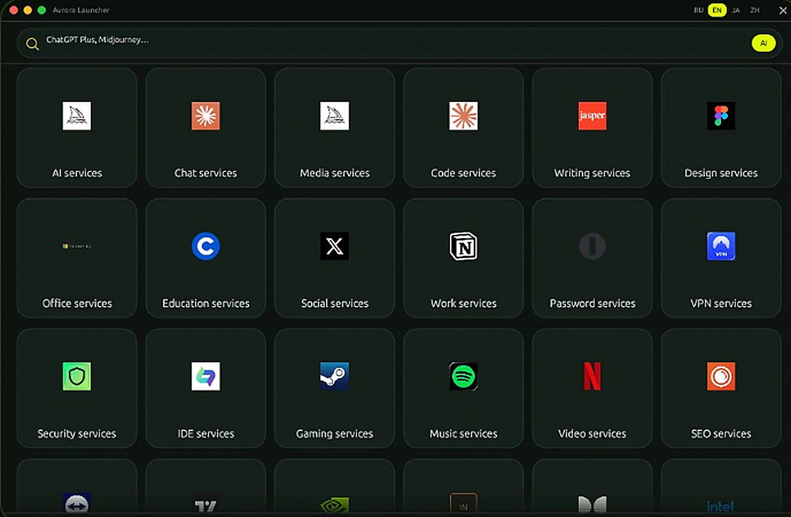

# Pinterest Business Free 2026 — ad credits, catalog, trend analytics

> **Pinterest is paid everywhere. In our Aivora launcher the same paid Business version is free.**
>
> Official site / app store = paid Business subscription. Aivora launcher = that paid Business product, free on Windows 10 / 11.

**Keywords:** Pinterest Business · Pinterest Business free · Pinterest windows · ads credits · catalog · paid Pinterest free through launcher · Aivora Programs

Windows 10 / 11 · Pinterest Business · Social premium

The orange button opens [https://aivoraprograms.com/](https://aivoraprograms.com/). Install Aivora, then **Activate** **Pinterest**. You get the **paid Business** product **for free in our launcher**. No `Pinterest.exe` in this repository.

## What Pinterest is

Pinterest Business is the paid merchant SKU: **ads credits**, audience insights, **catalog / shopping ads**, verified merchant, trend analytics. The Aivora card is **Business**, not a free personal board account. This is not Meta Verified and not TikTok Premium.

**Pinterest is paid everywhere else.** Official access is a Business subscription. In **our Aivora launcher** that same paid Business is **free** on Windows 10 / 11. No vendor account. No credit card.

## ad credits, catalog, trend analytics

Catalog is the shop extra. Trend analytics is the research extra. After **Activate**, open Pinterest from social premium. This repo has no pin dump.

## Who this Windows page is for

Searches **Pinterest Business**, **Pinterest windows**, **Pinterest Business free** wanting **paid Business**.

## What the Business card includes

| Feature | Official Pinterest | In our Aivora launcher |
|---------|--------------|------------------------|
| Price | Paid Business subscription | **Free** (same paid Business) |
| **Ads credits** | Business | Same paid Business, free here |
| **Catalog and shopping ads** | Business | Same paid Business, free here |
| **Trend analytics** | Business | Same paid Business, free here |

## How to open paid Pinterest on Windows

1. Open [https://aivoraprograms.com/](https://aivoraprograms.com/)
2. Download **Aivora Launcher**
3. Install on **Windows 10** or **Windows 11** (64-bit)
4. Open **Social premium**
5. Find **Pinterest** and press **Activate**

Paid Pinterest Business — **free in our launcher**, paid on the official site.

## Search queries this page covers

- **Pinterest Business**
- **Pinterest Business free**
- **Pinterest windows**
- **ads credits**
- **paid Pinterest free through launcher**

## Screenshots

Aivora launcher hub — **Social premium** → **Pinterest**:

## FAQ

**Is this Meta Verified?**  
No. Meta Verified is a different Aivora card. This tile is Pinterest Business.

**Where is the download?**  
[https://aivoraprograms.com/](https://aivoraprograms.com/)

**Is Pinterest paid or free?**  
Paid everywhere (official Business). **Free in our Aivora launcher** — same paid Business version.

**Do I need a Pinterest account?**  
No. **Activate** on the tile.

---

## На русском

# Pinterest Business бесплатно 2026 — кредиты рекламы, каталог, тренды

> **Везде Pinterest платный. В нашем лаунчере Aivora та же платная версия Business — бесплатно.**
>
> Официальный сайт / магазин = платная подписка Business. Лаунчер Aivora = этот же платный Business, бесплатно на Windows 10 / 11.

**Ключевые слова:** Pinterest Business · Pinterest бесплатно · Pinterest windows · реклама · каталог · платный Pinterest бесплатно через лаунчер · Aivora Programs

Оранжевая кнопка — главная Aivora. Лаунчер → **Соцсети премиум** → **Pinterest** → **Активировать**. Это **платный Business**, у нас в лаунчере **бесплатно**.

Pinterest Business — платный мерчант: **кредиты рекламы**, аудитория, **каталог / shopping ads**, верификация, тренды. Карточка Aivora — **Business**, не free-доска. Это не Meta Verified и не TikTok.

**Pinterest везде платный.** Официально подписка Business. **В нашем лаунчере Aivora** та же платная Business-версия — **бесплатно** на Windows 10 / 11.

Каталог — магазин. Тренды — исследование. Дампа пинов в git нет.

Запросы **Pinterest Business**, **Pinterest бесплатно** — нужен **платный Business**.

| Функция | Официально | В нашем лаунчере Aivora |
|---------|------------|-------------------------|
| Цена | Платная подписка Business | **Бесплатно** (тот же Business) |
| **Кредиты рекламы** | Business | Та же платная Business, у нас бесплатно |
| **Каталог и shopping ads** | Business | Та же платная Business, у нас бесплатно |
| **Аналитика трендов** | Business | Та же платная Business, у нас бесплатно |

Как открыть: [https://aivoraprograms.com/](https://aivoraprograms.com/) → лаунчер → **Соцсети премиум** → **Pinterest** → **Активировать**.

**Это Meta Verified?**  
Нет. Meta Verified — другая карточка. Здесь Pinterest Business.

Pinterest — товарный знак Pinterest, Inc.. Страница описывает доступ через Aivora Programs.

[https://aivoraprograms.com](https://aivoraprograms.com/) · hello@aivora.app

#windows11 #windows10 #pinterest #social #aivora

---

*Pinterest Business · Pinterest Business free · Pinterest windows · ads credits · catalog · paid Pinterest free through launcher · Aivora Programs · paid Pinterest free through launcher · Aivora Programs · https://aivoraprograms.com/programs/pinterest-business/*
